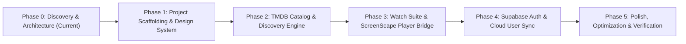

# VYBE — Project Master Plan
**Product:** VYBE — Premium Movie & TV-Series Streaming & Discovery Platform  
**Phase:** Phase 0 — Discovery, Architecture & Planning  
**Target Tech Stack:** Next.js (App Router), TypeScript, Tailwind CSS, Supabase (PostgreSQL + Auth), TMDB API, ScreenScape Embed

---

## 1. Product Vision & Brand Philosophy

**VYBE** is an ultra-modern streaming and entertainment discovery web application designed to merge the cinematic visual fidelity of premier streaming services (Netflix, Apple TV+, Prime Video) with the fluid browsing efficiency and user-first layout paradigms inspired by YouTube (frictionless sidebar navigation, compact/theater viewports, keyboard controls, responsive search overlay, and instant recommendations).

### Core Brand Attributes
- **Visual Identity:** Sophisticated, minimalist typography (Outfit / Inter), clean glassmorphism accents, obsidian dark mode (`#0b0b0f` base) with vibrant brand accents, and an equally crafted, readable, and non-glaring light mode.
- **Usability Focus:** Zero-friction discovery. Content is accessible within one click. Instant search modal with live TMDB autocompletion, category pill filters, responsive carousels, and an immersive watch page.
- **Playback Reliability:** Multi-source embedded video player powered by ScreenScape, with fallback support, audio language toggling, season/episode drawers, and cross-session progress tracking.

---

## 2. Scope & Target Capabilities

| Module | Core Deliverables |
| :--- | :--- |
| **Discovery & Home** | Hero banner featuring top trending title with backdrop, play/trailer actions; curated horizontal carousels (Trending Now, Top Rated Movies, Popular TV Series, Bollywood/Hindi Hits, Top Anime, Action, Comedy); category pills. |
| **Search & Browse** | Instant fuzzy search modal (`Cmd+K` / keyboard accessible), live result previews, dedicated browse page with advanced filtering (genre, year, vote average, sorting). |
| **Title Details Modal / Page** | High-definition backdrops, title metadata, genres, certification, runtime, cast & crew roster, official YouTube trailer embeds, and similar recommendations. |
| **Watch & Player Suite** | Full-width cinema mode, standard mode with sidebar suggestions; dynamic TV series drawer (Season tabs + Episode cards with thumbnails & descriptions); ScreenScape iframe player with `postMessage` synchronization. |
| **User State & Sync** | Guest mode (persisted to `localStorage` / IndexedDB) and Authenticated mode via Supabase (syncing Watchlist, Favorites, and Continue Watching across devices). |
| **Responsive & Themes** | Pixel-perfect responsiveness across mobile (360px+), tablet, and desktop (4K). Seamless Dark/Light theme switching with zero layout shift. |

---

## 3. Phased Implementation Roadmap

### Phase 0: Discovery, Architecture & Verification (Current Milestone)
- [x] Inspect existing workspace, tooling, dependencies, and git status.
- [x] Verify ScreenScape documentation, iframe URL patterns, query params, and `postMessage` protocol.
- [x] Identify documented vs. live-testing-required capabilities.
- [x] Formulate `PROJECT_PLAN.md`, `ARCHITECTURE.md`, `IMPLEMENTATION_STATUS.md`, and `.env.example`.
- [x] Await user review before generating UI or installing dependencies.

### Phase 1: Project Scaffolding & Foundation
- Initialize Git repository and create `.gitignore`.
- Scaffold Next.js (App Router) project with TypeScript, ESLint, and Tailwind CSS.
- Configure brand design system: font variables (Outfit/Inter), color palette (dark `#0b0b0f`, light `#f8fafc`, brand accent violet/indigo/amber), and theme provider.
- Set up core layout components: Header/Navbar, Collapsible Sidebar (YouTube-inspired), Search trigger, and Theme toggle.

### Phase 2: Metadata Engine & Catalog Integration (TMDB)
- Implement type-safe TMDB API client with server-side caching (`fetch` with Next.js revalidation tags).
- Build Catalog endpoints / Server Actions:
  - Trending Day/Week (Movies & TV)
  - Popular & Top Rated
  - Genre-based queries (Action, Sci-Fi, Horror, Animation/Anime, etc.)
  - Search Multi (Movies + TV) with debounce
  - TV Series details (Season & Episode listings)
- Construct UI components: Hero Carousel, Media Poster Cards, Genre Chips, Details Sheet/Modal.

### Phase 3: Watch Suite & ScreenScape Embedded Player
- Construct `/watch/[type]/[id]` page route.
- Implement isolated `ScreenScapePlayer` component with sandbox, fullscreen, and responsive aspect-ratio containment.
- Implement Season/Episode selector drawer for TV Series (`&s={season}&e={episode}`).
- Build the bidirectional `postMessage` listener and sender bridge:
  - Listen for `SCREENSCAPE_EMBED_READY`.
  - Handle `SCREENSCAPE_GET_PROGRESS`, `SCREENSCAPE_SET_PROGRESS`, and `SCREENSCAPE_GET_WATCH_HISTORY_WITH_PROGRESS`.
- Build guest-mode "Continue Watching" state manager with local storage fallback.

### Phase 4: Supabase Authentication & Multi-Device Sync
- Configure Supabase client (`@supabase/ssr` / `@supabase/supabase-js`).
- Database migration definitions:
  - `profiles`: user profile metadata.
  - `watch_history`: `tmdb_id`, `media_type`, `season`, `episode`, `progress_seconds`, `duration_seconds`, `updated_at`.
  - `watchlists`: bookmarked titles.
  - `user_preferences`: preferred audio language, default player size, theme mode.
- Implement Row Level Security (RLS) policies.
- Connect guest watch history migration to Supabase account upon sign-in.

### Phase 5: Accessibility, Performance & Quality Verification
- Audit keyboard navigation (tabbing, focus indicators, modal focus trapping).
- Full audit with Chrome DevTools MCP (A11y, LCP, CLS, contrast ratio in both dark & light modes).
- Responsive testing across mobile viewports, tablets, and ultrawide screens.
- Graceful error boundaries and fallback states when external video sources or TMDB are unreachable.

---

## 4. Risk Analysis & Mitigation Strategies

| Risk | Impact | Mitigation Strategy |
| :--- | :--- | :--- |
| **Embed Iframe Sandboxing / Ad Intrusion** | Medium | ScreenScape embeds may include ad scripts. Test `sandbox="allow-scripts allow-same-origin allow-forms allow-presentation"` carefully to prevent unwanted redirects while preserving playback functionality. |
| **Third-Party Storage Partitioning in Browsers** | Medium | Modern browsers (Safari ITP, Chrome CHIPS) isolate iframe local storage. Rely on the parent app's Supabase database / local storage as the primary source of truth for watch progress, sending `SCREENSCAPE_SET_PROGRESS` into the player. |
| **TMDB API Rate Limiting** | Low | Next.js Server Components and cache tags (`next: { revalidate: 3600 }`) will cache catalog responses server-side, reducing client-side requests to TMDB. |
| **Missing Streams for Niche Titles** | Medium | Detect error events or fallback to alternate server parameters / direct download links (`/download/movie/{tmdbId}`). |
